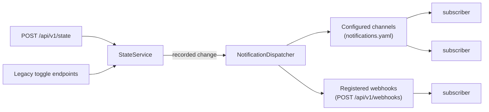

# Notifications

Every time the space opens or closes, spacestate tells whoever is listening.
This page covers how that works, how to configure it, and how to add a new
kind of listener. The code is in
[`src/notifications/`](https://github.com/pixelbar/spacestate/tree/main/src/notifications).

## What triggers a notification

A notification is sent for every **recorded** state change, whichever way it
came in: `POST /api/v1/state` or the legacy toggle endpoints the hardware uses.
A request for the state the space is already in records nothing and notifies
nobody.

## How it works



- A **subscriber** is one place a notification goes, such as one account or
  one URL. It makes a single attempt each time it is asked, and
  reports a failure by throwing.
- A **subscriber source** hands the dispatcher its current subscribers. It is
  asked again on every change, so its list can change while the app runs.
  There are two: the operator's channels in `notifications.yaml`, and the
  [webhooks](/maintainers/notifications/webhooks) clients register through the
  API.
- The **dispatcher** decides when and how often to ask each subscriber.

### Delivery rules

| Rule | Behaviour |
| --- | --- |
| Fire and forget | The request that changed the state never waits for a notification. It has already been answered by the time anything is sent. |
| Timeout | 10 seconds per attempt, unless a channel type sets its own. |
| Retries | After 1 s, 5 s and 30 s: four attempts in all. A subscriber can declare a failure final (a revoked token, a ban), and it is not retried. |
| Ordering | Each subscriber gets changes in the order they happened. The next one waits until the previous one is delivered or given up on. |
| Isolation | Subscribers are independent: one that is slow or failing never delays or blocks another. |
| Shutdown | On shutdown, retries stop and anything still queued is dropped (and logged). Attempts already under way finish. |

Delivery state is kept in memory only. A notification that is still waiting
for a retry when the app stops is lost; with one replica that scales down only
after minutes without traffic, that window is small.

## Configuring channels

Channels are configured in `notifications.yaml`. A minimal one:

```yaml
timeZone: Europe/Amsterdam         # for {time} and {date}; this is the default

messages:                          # optional; replaces the defaults below
  open: "{space} is open."
  closed: "{space} is closed."

channels:
  - type: example                  # a channel type, see the list at the end
    id: pixelbar                   # names it in logs as example:pixelbar
    enabled: true                  # false keeps the entry without posting
    messages:                      # optional, for this channel only
      open: "{space} is open — come by!"
    # …the settings that type needs
```

| Field | Meaning |
| --- | --- |
| `timeZone` | IANA zone used for `{time}` and `{date}`. Defaults to `Europe/Amsterdam`. |
| `messages` | Templates for `open` and `closed`, for every channel. Either can be left out. |
| `channels[].type` | The channel type. An unknown type fails validation and lists the known ones. |
| `channels[].id` | Unique within the file; lowercase letters, digits, `-` and `_`. Appears in logs, so keep secrets out of it. |
| `channels[].enabled` | Defaults to `true`. |
| `channels[].messages` | Templates for this channel, overriding everything else. |

Every entry is checked against its own type's rules when the file is loaded,
and by `just edit notifications` before it is pushed. A misspelt field is
caught there, not at the next state change.

The file holds credentials (access tokens, passwords), so treat it like
`api-keys.yaml`. It is not in the repository; the sample with placeholder
values is
[`config/notifications.sample.yaml`](https://github.com/pixelbar/spacestate/blob/main/config/notifications.sample.yaml).

### Messages

Templates can use these placeholders:

| Placeholder | Becomes |
| --- | --- |
| `{space}` | The `space` name from `spaceapi.json`, e.g. `Pixelbar` |
| `{state}` | `open` or `closed` |
| `{previousState}` | `open` or `closed` |
| `{changedBy}` | Whoever flipped the switch (the request's `user`) |
| `{method}` | How, e.g. `Spacestate Switch` |
| `{time}` | When, as `HH:mm` (24-hour) in `timeZone` |
| `{date}` | When, as `YYYY-MM-DD` in `timeZone` |

An unknown placeholder fails validation. `{changedBy}` is a person's name, and
most channels are public, so use it deliberately.

For each state, a channel's message comes from the first of these that sets
it:

1. the channel's own `messages`;
2. the document's `messages`;
3. the channel type's defaults, for types with a reason to differ (one that
   refuses repeated posts needs a time in every message, say);
4. `{space} is open.` / `{space} is closed.`

Document-wide `messages` therefore also replace a channel type's defaults. Check
the channel's page before setting them.

## Changing the live configuration

```sh
just edit notifications    # pull, edit in $EDITOR, validate, show the diff, confirm, push
```

The app picks up the new file within five minutes; no restart or redeploy is
needed. Rotating a token is just an edit.

The file is **optional**. If it is missing, the app runs normally and announces
nothing. If an edit makes it invalid at startup, the app does the same and
reports the error to Sentry. A reload that fails while running keeps the last
good version. Either way, the space state keeps being served.

To turn a channel off temporarily, set `enabled: false` rather than deleting
the entry. Its credentials stay where they are.

## Seeing what happened

Each outcome is logged to Sentry Logs (and the Container Apps log stream) with
the subscriber's id (`<type>:<id>`, e.g. `example:pixelbar`), a `deliveryId` that is the same
across retries, the `state` and, for failures, an `error`:

| Message | Level | Meaning |
| --- | --- | --- |
| `Notification delivered` | info | Done; `attempt` says which try worked. |
| `Notification attempt failed; retrying` | info | Will retry. Expected now and then. |
| `Notification delivery failed` | warn | Gave up, either after the last retry or on a failure marked final. `error` says why. |
| `Notification dropped: shutting down before it was sent` | warn | The app stopped with this one still queued. |
| `Notification channel could not be set up; it will not be notified` | error | A channel's entry passed validation but could not be built. |
| `Notification subscriber source failed; skipping it for this change` | error | A whole source failed. Its subscribers missed this change; the others did not. |

Errors are written by the channel code and never include tokens. Anything
unexpected is logged by its error name only, because some library errors quote
URLs that may hold a secret.

To find out why a channel went quiet, search the logs for its subscriber id.

## Adding a channel type

A channel type is one module in
[`src/notifications/channels/`](https://github.com/pixelbar/spacestate/tree/main/src/notifications/channels)
that exports a `ChannelType`, plus one line registering it:

```ts
// src/notifications/channels/example.ts
import { z } from "zod";
import { channelBaseSchema, defineChannelType } from "../channel.js";
import { DeliveryError, httpDeliveryError } from "../types.js";

export const exampleChannel = defineChannelType({
  type: "example",
  // Extends the shared fields (id, enabled, messages) with this type's own.
  schema: channelBaseSchema.extend({
    type: z.literal("example"),
    url: z.string().url(),
    token: z.string().min(1),
  }),
  // Optional: defaults for this type, used below the document's messages.
  defaultMessages: { open: "{space} opened at {time}." },
  // Called for each enabled entry, and again after every config reload.
  create: (config, context) => ({
    timeoutMs: 10_000, // optional; the dispatcher's default otherwise
    deliver: async (notification, delivery) => {
      const response = await context.fetch(config.url, {
        method: "POST",
        headers: { authorization: `Bearer ${config.token}` },
        body: context.message(notification), // the rendered template
        signal: delivery.signal, // aborted when the attempt times out
      });
      // 2xx passes; 408/429/5xx retry; anything else is final.
      const error = httpDeliveryError(response.status);
      if (error) throw error;
    },
  }),
});
```

```ts
// src/notifications/channels/index.ts
export const CHANNEL_TYPES: readonly AnyChannelType[] = [/* … */, exampleChannel];
```

Registering it is all the wiring needed. The config schema, `just edit`
validation and delivery all read from that list.

What a `deliver` function must do:

- **Make one attempt.** Retries, timeouts and ordering are the dispatcher's
  job.
- **Throw to fail.** Throw `new DeliveryError(message, { retryable: false })`
  when retrying cannot help; anything else thrown is retried. A
  `DeliveryError`'s message is logged as is, so build it yourself and keep
  credentials out of it.
- **Honour `delivery.signal`.** Pass it to `fetch` or close the socket when it
  aborts. The dispatcher stops waiting at the timeout either way, but an
  abandoned connection would otherwise linger.
- **Use `delivery.id` as an idempotency key** where the receiving API takes
  one. It stays the same across retries of one notification.

Then add a disabled example entry to `config/notifications.sample.yaml` (a test
checks the sample stays valid), tests next to the others in `test/unit/`, and a
page in this section.

## Channel types

None yet: each configured channel type ships in its own release.

Separately from channels, clients can register their own URLs through the
API. See [Webhooks](/maintainers/notifications/webhooks).
