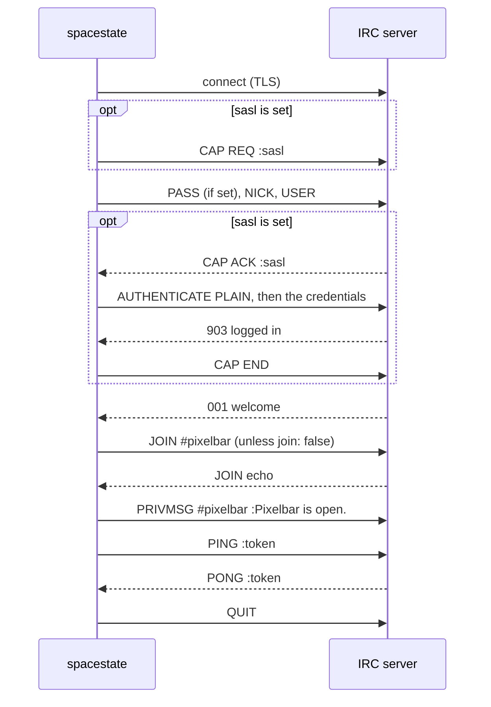

# IRC

The `irc` channel type says each state change in one or more IRC channels. The
code is
[`src/notifications/channels/irc.ts`](https://github.com/pixelbar/spacestate/blob/main/src/notifications/channels/irc.ts).

## A connection per change

There is no resident bot. Each change opens a connection, registers, joins,
speaks and quits. The app scales to zero when idle, so a standing connection
would keep dropping and rejoining anyway. State changes are rare enough that a
join and a part each time is the lesser noise, and `join: false` removes even
that for channels that allow it.



The delivery only counts once the `PONG` comes back. The server handles
commands in order, so any complaint about the message (`cannot send to
channel`, a ban) arrives before it and fails the delivery, instead of a
message vanishing while the log says it was delivered.

The server's `PING`s during registration are answered. A taken nick gets a
digit appended (`pixelbar-state1`, then `pixelbar-state2`), after which the
attempt fails and is retried. Each attempt may take 30 seconds, longer than the
usual 10, because some networks are slow to register while they look up ident
and the hostname.

## Setting it up

1. Pick a nick for the bot. On networks with services (NickServ), register it,
   and use those credentials for `sasl`. Some networks only accept connections
   from cloud providers' addresses, Azure's included, with SASL, and channels
   set `+r` only let registered nicks join.
2. If the channel is moderated (`+m`), give the nick voice, or messages are
   refused.
3. Add the channel with `just edit notifications`:

```yaml
channels:
  - type: irc
    id: libera                    # logged as irc:libera
    server: irc.libera.chat
    nick: pixelbar-state
    sasl:
      account: pixelbar-state
      password: "…"
    channels: ["#pixelbar"]
```

## Settings

| Field | Default | Meaning |
| --- | --- | --- |
| `server` | | Hostname. With TLS, the certificate must be valid for it. |
| `port` | `6697` with TLS, `6667` without | |
| `tls` | `true` | Plain-text connections send the SASL password in the clear; avoid them. |
| `nick` | | A valid IRC nick, up to 30 characters, starting with a letter or a symbol such as `_` or `[`. |
| `username` | the nick | The ident part of `nick!user@host`. |
| `realname` | `Pixelbar space state` | Shown in `/whois`. |
| `password` | | Server password (`PASS`), for networks or bouncers that need one. Not the NickServ password. |
| `sasl.account`, `sasl.password` | | Log in to a services account with SASL PLAIN before registering. |
| `channels` | | At least one, e.g. `["#pixelbar", "#pixelbar-bots"]`. Channel keys (`+k`) are not supported. |
| `join` | `true` | `false` sends without joining, for channels that accept outside messages (no `+n`). |
| `notice` | `false` | `true` sends a `NOTICE`, which bots are conventionally expected to use, instead of a `PRIVMSG`. |

Plus the shared `id`, `enabled` and `messages` described in
[Configuring channels](/maintainers/notifications/#configuring-channels). The
default messages are `{space} is open.` and `{space} is closed.` Each line of a
message becomes its own IRC line, cut at 350 bytes (with `...`) so the server's
relay of it fits IRC's 512-byte limit.

## What each outcome means

| Server says | Outcome | Logged as |
| --- | --- | --- |
| `PONG` after the message | Delivered | |
| `904`/`902`/`905`/`906`/`908`, or `CAP NAK` | Final | `SASL: authentication failed (904)` and similar |
| `464` | Final | `the server refused the password (464)` |
| `432` | Final | `the server refused the nick (432)` |
| `465` | Final | `this client is banned from the server (465)` |
| `471`/`473`/`474`/`475`/`477`/`403`/`405` on join | Final | `#pixelbar: banned from channel (474)` and similar |
| `404` after the message | Final | `#pixelbar: cannot send to channel (404)` |
| Nick still taken after two alternatives | Retried | `nick … and its alternatives are in use` |
| `ERROR` and hang-up | Retried | `server closed the connection: Closing Link: … (Throttled: …)` |
| Connection refused, DNS failure | Retried | `connection to irc.example:6697 failed: ECONNREFUSED` |
| No `PONG` within 30 s | Retried | `timed out after 30000 ms` |

With several channels, one refusal fails the whole delivery, and a retry sends
to every channel again. IRC has no idempotency, so a retry after the message
went out but before the `PONG` returned repeats it. That is rare, and was judged
better than a message silently lost.

## When it goes quiet

Search the logs for `irc:<id>`.

- **`cannot send to channel (404)`:** the channel is `+n` and `join` is
  `false`, or it is `+m` and the nick has no voice.
- **`channel needs a registered nick (477)`** or a refused connection from a
  network that wants SASL: register the nick and set `sasl`.
- **`Throttled`** in a hang-up: several changes in quick succession reconnected
  faster than the network allows. Retries usually get through; if not, the
  change is lost and the next one posts as normal.
- **The bot flickers in and out of the channel:** that is the join and part
  around each message. Use `join: false` if the channel allows outside
  messages, or `notice: true` so clients that hide bot noise can hide it.
