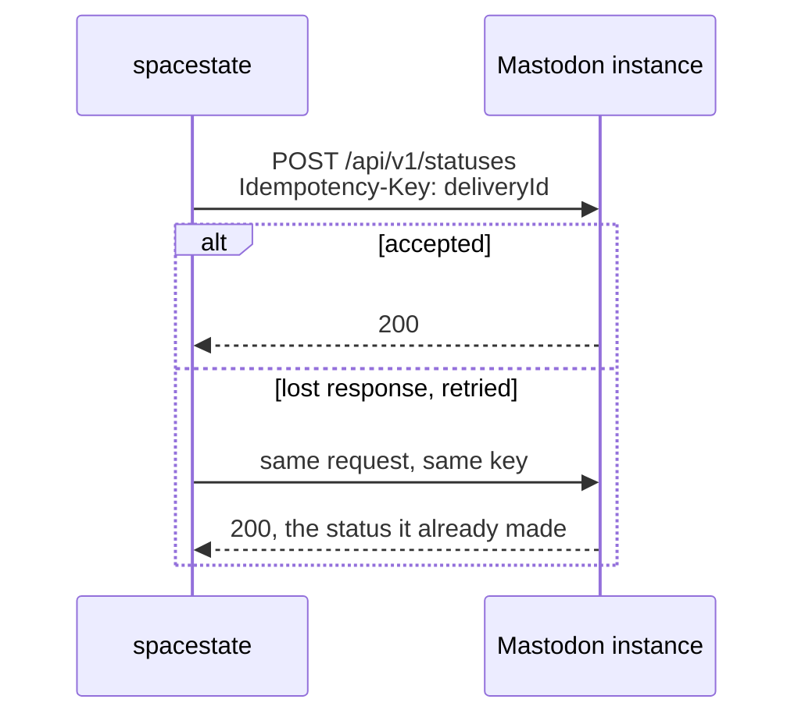

# Mastodon

The `mastodon` channel type posts each state change as a status on one
Mastodon account. The code is
[`src/notifications/channels/mastodon.ts`](https://github.com/pixelbar/spacestate/blob/main/src/notifications/channels/mastodon.ts).

## Setting it up

1. Log in to the account that should post, on its home instance.
2. Open **Preferences → Development → New application**. Give it a name
   (`spacestate`), clear every scope, and tick only **`write:statuses`**. That
   lets the token post and nothing else: no reading, no following, no account
   changes.
3. Save, open the application, and copy **Your access token**.
4. Add the channel with `just edit notifications`:

```yaml
channels:
  - type: mastodon
    id: pixelbar                        # logged as mastodon:pixelbar
    instance: https://mastodon.example  # the account's home instance
    accessToken: "…"
    visibility: public                  # optional
    language: nl                        # optional
```

It takes effect within five minutes. The next state change posts.

::: warning Turn off the old poster
Until now a separate VPS has posted the space state to Mastodon. Switch it off
when this channel goes live, or every change is announced twice.
:::

## Settings

| Field | Required | Meaning |
| --- | --- | --- |
| `instance` | yes | Base URL of the account's instance. Must be `https://`; a trailing slash is ignored. |
| `accessToken` | yes | The application's access token (`write:statuses`). |
| `visibility` | no | `public` (default), `unlisted` (not in public timelines), `private` (followers only) or `direct`. |
| `language` | no | Two-letter ISO 639-1 code, e.g. `nl`. Unset, the instance guesses. |

Plus the shared `id`, `enabled` and `messages` described in
[Configuring channels](/maintainers/notifications/#configuring-channels). The
default messages are `{space} is open.` and `{space} is closed.`

## What happens on a change



Every attempt carries the delivery id as an `Idempotency-Key`. Mastodon
remembers it for an hour and answers a repeat with the status it already
created, so a retry after a timed-out response cannot post twice.

| Response | Outcome |
| --- | --- |
| `2xx` | Posted. |
| `401`, `403` | Final: the token is wrong, revoked, or lacks `write:statuses`. |
| `422` | Final: Mastodon refused the post, e.g. over the instance's character limit (500 by default). |
| `408`, `429`, `5xx`, timeout, network error | Retried after 1 s, 5 s and 30 s. |
| `3xx` | Final. Redirects are not followed, so the token never travels to another host. |

## When it goes quiet

Search the logs for `mastodon:<id>`. A `Notification delivery failed` entry
quotes Mastodon's own reason, for example
`HTTP 401: The access token is invalid`.

- **401 after it used to work:** the token was revoked, or the application was
  deleted. Make a new one (step 2 above) and update `accessToken`.
- **422:** the message is too long or empty for that instance. Shorten the
  channel's `messages`.
- **Repeated 5xx or timeouts:** the instance is having a bad day. Nothing to
  fix here; changes that ran out of retries are not posted later.

## Rotating the token

Create a new application (or regenerate the token on the existing one), put the
new token in with `just edit notifications`, and delete the old application
once a change has posted. There is no gap: until the reload, the app keeps
using the old token.
