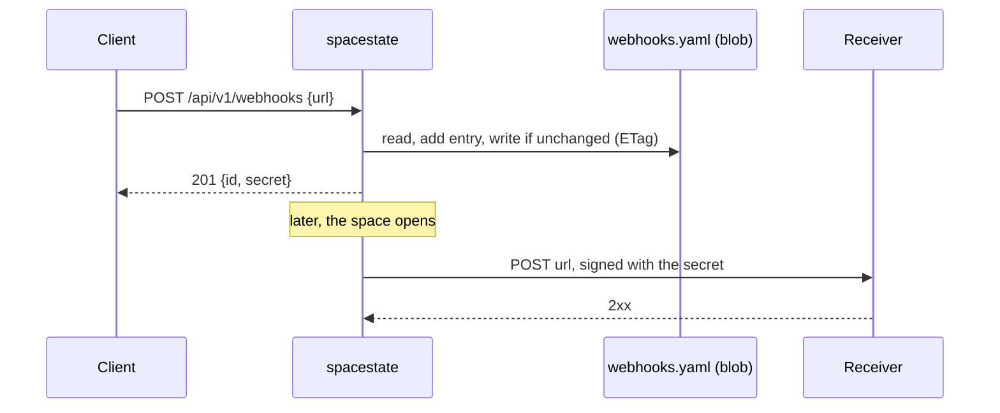

# Webhooks

Webhooks let other software be told when the space opens or closes, instead of
polling `GET /api/v1/state`. Unlike the other channels, they are not
configured by a maintainer: clients register their own URLs through the API.
The contract a receiver can rely on (payload, signature, retries) is in the
[API reference](/operations/registerWebhook). This page covers running them.

The code is in
[`src/notifications/webhooks/`](https://github.com/pixelbar/spacestate/tree/main/src/notifications/webhooks)
and
[`src/api/routes/webhooks.ts`](https://github.com/pixelbar/spacestate/blob/main/src/api/routes/webhooks.ts).

## How it fits together



Registered webhooks are a subscriber source of their own, next to the
configured channels in `notifications.yaml`. Each registration is one
subscriber, logged as `webhook:<id>` (e.g. `webhook:wh_3f9a1c2b7d4e`), so it
gets the usual [delivery rules](/maintainers/notifications/#delivery-rules):
in order, with retries, independent of every other subscriber.

## Registrations

Managing webhooks needs an API key with the `write` role:

| Operation | Notes |
| --- | --- |
| [Register](/operations/registerWebhook) | `POST /api/v1/webhooks`. Returns the signing `secret` once; it cannot be shown again. |
| [List](/operations/listWebhooks) | `GET /api/v1/webhooks`. Without secrets. |
| [Remove](/operations/deleteWebhook) | `DELETE /api/v1/webhooks/{id}` |

Each key sees and manages only the webhooks it registered. Another key's id
answers `404`, the same as an id that never existed, because a URL can embed a
secret of its own. A key can hold up to 20 registrations, and registering the
same URL twice answers `409` with the existing id.

## Where registrations live

In `webhooks.yaml`, which the app writes itself. In production this is a blob
in its own `webhooks` storage container. That container is the only one the
app's identity may write to: the `config` container stays read-only, so a
compromised app could change who is notified but not mint API keys.

```yaml
webhooks:
  - id: wh_3f9a1c2b7d4e
    url: https://hooks.example.org/pixelbar
    secret: "…"                     # HMAC key for the signature
    description: Door sign          # the registrant's note: who to contact
    createdAt: "2026-10-20T18:00:00.000Z"
    createdBy: ha-bridge            # id of the API key that registered it
```

- **Concurrent writes** are safe. Every change reads the blob, applies itself
  and writes back only if the blob is unchanged (an ETag condition), retrying
  on conflict. Two registrations at the same moment do not lose each other.
- **Freshness:** the app rereads the file every minute, and immediately after
  its own writes.
- **Missing file** means no webhooks yet. Nothing needs uploading on a new
  deployment; the first registration creates it. An unreadable file is
  reported to Sentry and leaves the last known list in place. It never stops
  the state from being served.

## Delivery

On every recorded state change, each registered URL gets a JSON `POST`:

| Aspect | Behaviour |
| --- | --- |
| Body | `event`, `deliveryId`, `state`, `previousState`, `changedAt`, `changedBy`, `method`, `source` |
| Signature | `X-Spacestate-Signature: sha256=<hex>`, the HMAC-SHA256 of `<timestamp>.<body>` keyed with the secret, with the timestamp in `X-Spacestate-Timestamp` |
| Timeout | 5 seconds per attempt |
| Retried | Timeouts, network errors, `5xx`, `408` and `429`, with the same `deliveryId` |
| Final | Any other status. A `3xx` too: redirects are not followed, so a signed request is never bounced somewhere unregistered. |

Receivers verify the signature over the raw body and should reject timestamps
far from their clock, which stops replays.

## Which URLs are allowed

A target must be a public `https://` URL. These are refused at registration
(`400 invalid_url`):

- `http://` and other schemes;
- credentials in the URL (`https://user:pass@…`);
- `localhost`, `*.localhost`, `*.local` and `*.internal`;
- private, loopback, link-local (including the cloud metadata address),
  CGNAT, multicast and reserved IP addresses, in IPv4, IPv6 and IPv4-mapped
  IPv6 form.

DNS can change after registration, so every delivery resolves the hostname
again and refuses one that now points at a private address. That refusal is
final, not retried. A small gap remains between that lookup and the
connection (DNS rebinding); `https` and never reading the response back keep
it low-impact.

For local development only, two environment variables relax the rules:

| Variable | Allows |
| --- | --- |
| `WEBHOOK_ALLOW_INSECURE=true` | `http://` targets |
| `WEBHOOK_ALLOW_PRIVATE_TARGETS=true` | Loopback and private addresses |

Never set these in production.

## Day-to-day

**Removing a webhook for its owner**, say when a receiver is gone and every
change fails: edit the file directly, which takes effect within a minute.

```sh
just edit webhooks
```

Prefer the API when you have the owning key. The live file may have changed
since you pulled it; the diff shown before the push is the safeguard against
overwriting newer registrations.

**Revoking an API key does not remove its webhooks.** They keep being
delivered, but nobody can list or delete them through the API any more, and a
new key given the same id would inherit them. Remove them from
`webhooks.yaml` (search for `createdBy: <key id>`) when you revoke the key.


**Finding out why a receiver hears nothing:** search the logs for
`webhook:<id>`. `Notification delivery failed` carries the reason: an HTTP
status, `target resolves to a private address`, or a network error.

## Deploying

`terraform apply` creates the `webhooks` container, grants the app's identity
Storage Blob Data Contributor on that container only, and sets
`WEBHOOKS_CONFIG_SOURCE`. Locally that variable defaults to
`config/prod/webhooks.yaml`; `config/webhooks.sample.yaml` shows the shape.
