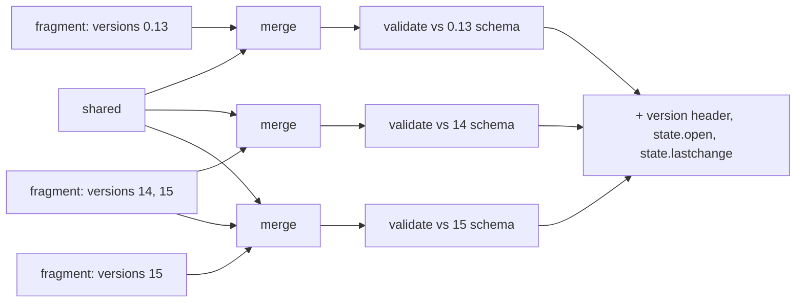

# SpaceAPI document

The [SpaceAPI](https://spaceapi.io/) document is how hackerspace status tools,
and the [SpaceAPI directory](https://directory.spaceapi.io/), learn who we are
and whether we're open. spacestate serves it in every version it supports,
from one config document, `spaceapi.yaml`. What consumers can rely on is in
the [API reference](/operations/getSpaceApiVersion); this page covers editing
it.

The code is in
[`src/domain/spaceapi/`](https://github.com/pixelbar/spacestate/tree/main/src/domain/spaceapi).

## Versions and addresses

| Address | Serves |
| --- | --- |
| `/`, `/api/v1/spaceapi`, `/index.php` | The latest version, **15**. `https://spaceapi.pixelbar.nl/` is the address the directory lists. |
| `/api/v1/spaceapi/13` (or `/0.13`), `/14`, `/15` | That version. |
| `/spaceapi/13.json`, `/14.json`, `/15.json` | The same, as short addresses. |

Each document claims exactly one version (`api: "0.13"`, or
`api_compatibility: ["14"]` / `["15"]`). The service fills in that header,
`state.open` and `state.lastchange`; everything else comes from
`spaceapi.yaml`.

## How a document is built



The merge and validation happen when the config is loaded, so a request only
adds the live fields.

## Editing `spaceapi.yaml`

```sh
just edit spaceapi              # prod; add --env dev for dev
```

The file has two parts:

```yaml
shared:            # what every version has
  space: Pixelbar
  location:
    address: Unit K14.1.01, Schiemond 20, 3024 EE Rotterdam
    lat: 51.903083
    lon: 4.449638
  contact:
    email: bestuur@pixelbar.nl

versioned:         # what only some versions have
  - versions: ["0.13"]
    issue_report_channels: [email]
  - versions: ["14", "15"]
    location:
      timezone: Europe/Amsterdam
  - versions: ["15"]
    location:
      country_code: NL
```

The rules:

- **A fragment is deep-merged into `shared`** for each version it lists:
  objects merge key by key, so the v15 document above has `address`, `lat`,
  `lon`, `timezone` and `country_code`. Anything that isn't an object (a
  string, number or list) is a single value.
- **A value has one home per version.** Setting `contact.email` in `shared`
  and again in a fragment, or in two fragments for the same version, is an
  error rather than an override. To give versions different values, take it
  out of `shared` and put it in one fragment per value.
- **Quote the versions** (`"14"`, not `14`): `0.13` and `14` are names, not
  numbers.
- **Don't set the live fields**: `api`, `api_compatibility`, `state.open`,
  `state.lastchange`. The config is refused if you do.

## Validation

Every version is rendered and checked against its
[official schema](https://github.com/SpaceApi/schema), in **strict** mode. The
published schemas accept any key, so on their own they would pass
`issue_report_channels` in a v15 document, a field v14 removed. Strict mode
rejects a key that version doesn't define, so the mistake is caught here
instead of by a consumer.

Custom fields are allowed if their name starts with `ext_`, which the spec
reserves for them. That is why Discord is `contact.ext_discord`: no SpaceAPI
version has a Discord field. For the same reason 0.13 carries
`contact.ext_mastodon`, because `mastodon` only exists from 14.

A failed check says which version and which key:

```text
SpaceAPI 15: issue_report_channels is not part of SpaceAPI 15 (tag it for the versions that have it, or prefix it ext_)
SpaceAPI 15: membership_plans.0.value must be number
contact.email is set by both shared and versioned[1] for 14; give it one home
```

Where it runs:

- `just edit spaceapi` and `just push spaceapi` refuse to upload a file that
  fails it.
- `just check-spaceapi config/prod/spaceapi.yaml` checks a local copy (after
  `just pull spaceapi`). Add `--print 15` to see exactly what `/api/v1/spaceapi/15`
  would serve.
- The app checks every reload. A file that fails is not used: the app keeps
  serving the last good one and reports `Config reload failed` to Sentry.
- On a PR, the **SpaceAPI schema** workflow checks
  `config/spaceapi.sample.yaml` and requests every SpaceAPI address, whenever
  the sample, the SpaceAPI code or the vendored schemas change.

## Adding a SpaceAPI version

When the SpaceAPI publishes a new version (16 is a draft at the time of
writing):

1. Copy its schema from
   [SpaceApi/schema](https://github.com/SpaceApi/schema) into
   `src/domain/spaceapi/schemas/`, unedited, and update the commit noted in
   `versions.ts`.
2. Add it to `SPACEAPI_VERSIONS` and `SPACEAPI_SCHEMAS` in `versions.ts`. The
   last entry is the latest, so `/` moves to it.
3. Add it to the `versions` of every fragment it should inherit (in the sample
   and in prod's and dev's `spaceapi.yaml`), and add fragments for what's new.
   `just check-spaceapi` tells you what the new schema doesn't accept.
4. Update the version enums in `docs/openapi.yaml`, and the CHANGELOG.

Push the config with the new version tagged *after* the release that serves
it: until then, the running app refuses a fragment for a version it doesn't
know.
